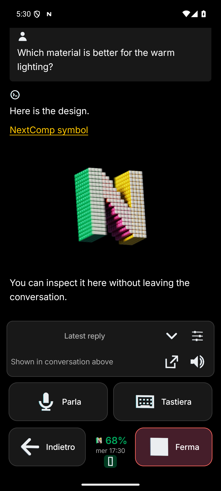

# Images inside conversations

NextComp renders linked images in the conversation itself. Tap a preview to open its native full-screen viewer, pinch/pan to inspect it, and use the bottom Close image control to return to the same conversation. Viewing an image does not require a gallery app or browser.



This screenshot uses an isolated synthetic conversation and the app's own symbol asset; it contains no private task content.

## Supported links

Markdown image syntax works even when the URL has no filename extension:

```markdown
Here is the proposed composition.


The second version uses a warmer light.
```

Ordinary Markdown links and bare URLs ending in PNG, JPEG, GIF, WebP, BMP, AVIF or SVG are recognized as image candidates. Opaque `/api/files/...` links are checked for an image MIME type before showing a preview. Non-image files remain normal text links. Explicit image attachments use their declared MIME and the same native viewer. SVG and animated GIF use explicitly registered matching Coil decoders; other decoding depends on Android and the installed image library. Unsupported/broken images retain their text/link and offer Retry.

Images remain next to their surrounding prose, including within a paragraph. Image presentation does not alter the canonical text or offsets used by optional inline immersion. Italian phrase taps still switch the text in place; viewing an image does not introduce a translated line or help modal.

To show an image stored only on the execution host, an agent should share that exact file through the existing authenticated attachment path, or link to an HTTPS image resource the phone can reach. The notification tool's `files` argument supports explicitly requested local attachments. A raw workstation filesystem path is not a phone-download URL. Links to a gallery card (`/8bar/#card-id`) resolve its published preview directly. Other gallery pages remain ordinary links. The original link remains available beside the preview.

## Loading and access

Previews reserve 240dp while loading, so completion of a known image request does not jump the text around. Decoding is capped at 1200px for previews and 2400px for the viewer; the encoded response is capped at 12 MiB, including streaming responses, with a 20-second request deadline. Up to eight distinct candidates per paragraph are considered. This is a preview/viewing path, not a transfer of an unbounded original master.

Only an exact paired-backend origin and `/api/files/` path receive the pairing bearer token. Authenticated attachment redirects are blocked and cache keys separate pairing credentials. Public images carry no pairing header and may follow normal public redirects. Both paths reuse NextComp's existing network client and verified-workstation DNS recovery; they do not relax TLS verification. Other services that require login are not given credentials automatically.

Opaque file links use a HEAD MIME check, falling back to a Range GET when HEAD is unsupported. Successful non-image responses reserve no image space. The existing attachment-open behavior remains available for non-image files.

## Implementation and qualification

[Markdown parsing](../android/app/src/main/java/co/fallsoft/pocket/MarkdownContent.kt) retains image positions, [rendering](../android/app/src/main/java/co/fallsoft/pocket/MarkdownRenderer.kt) slices already annotated text, and [native image loading/viewing](../android/app/src/main/java/co/fallsoft/pocket/LinkedImage.kt) handles access and bounds. The same image flow is used in [immersion content](../android/app/src/main/java/co/fallsoft/pocket/BilingualMessage.kt) and explicit image attachments.

Runtime observations are recorded separately from source claims in the release qualification. Synthetic emulator images establish UI/transport behavior with controlled inputs; they do not establish access to arbitrary private image services or a permanent fix for phone DNS.

## Gallery-card metadata

The gallery publishes `showcase-previews.json` alongside its full catalog:
`{"version":1,"cards":[{"id":"card-id","title":"Title","poster":"card/poster.png","video":"card/preview.mp4","width":800,"height":600}]}`.
Only those six fields belong in this projection; downloads, production notes and
source archives remain in the full gallery catalog. The publisher integration
patch is retained in `integrations/gallery/preview-projection.patch`.

Android and web bound this metadata to4MiB/20,000cards, coalesce concurrent reads
and cache briefly. Only a404 uses the old16MiB full-catalog fallback. No pairing
credential is sent to gallery metadata or media. Failed browser previews expose
Retry; they do not silently disappear or poll in the background.

The private compatibility web origin must mirror the existing `/8bar/` static
route. The browser maps only canonical HTTPS links on its own hostname to that
same-origin mirror. Other hosts, arbitrary ports and credential-bearing links
are not rewritten. The gallery remains tailnet-only; no CORS wildcard, new
public listener or application authentication exception is needed.
